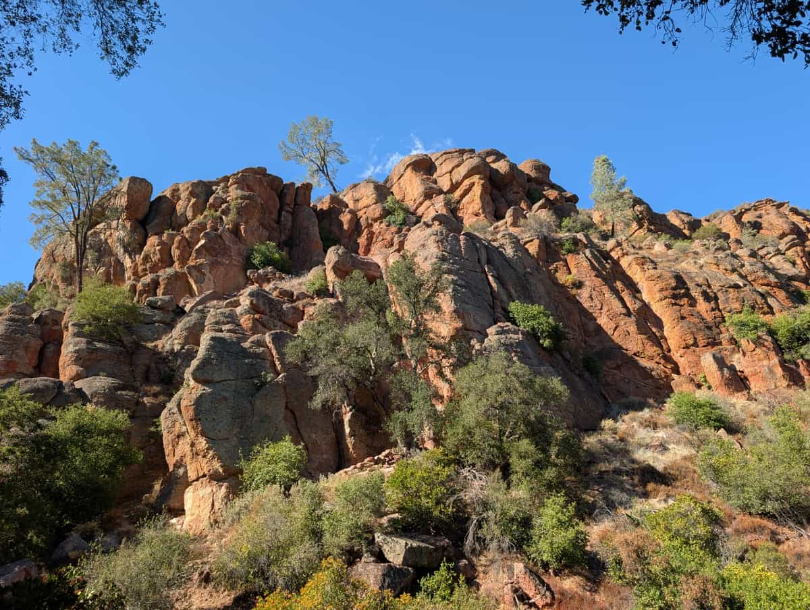
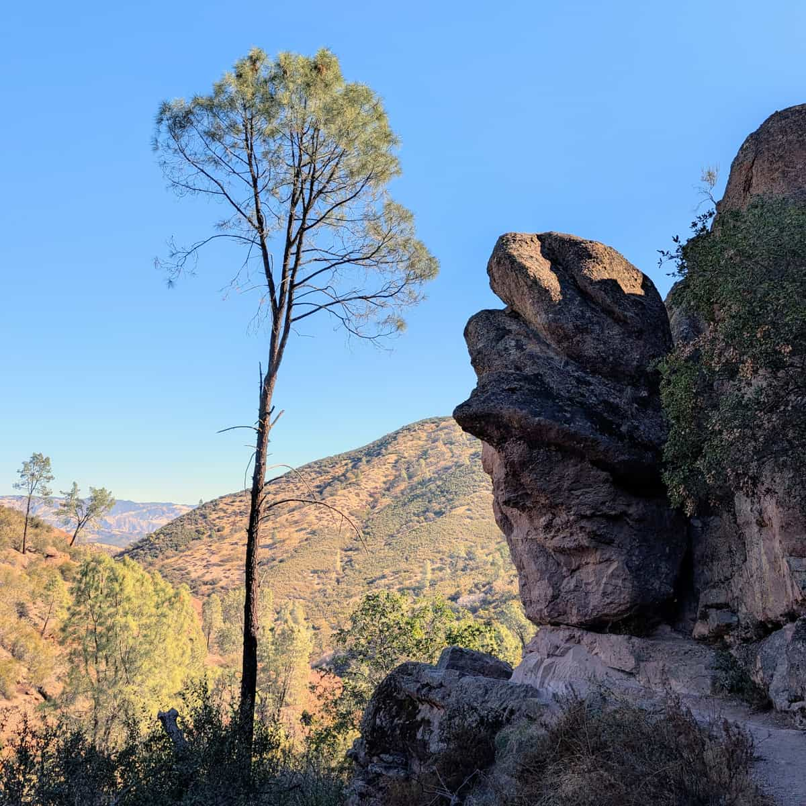
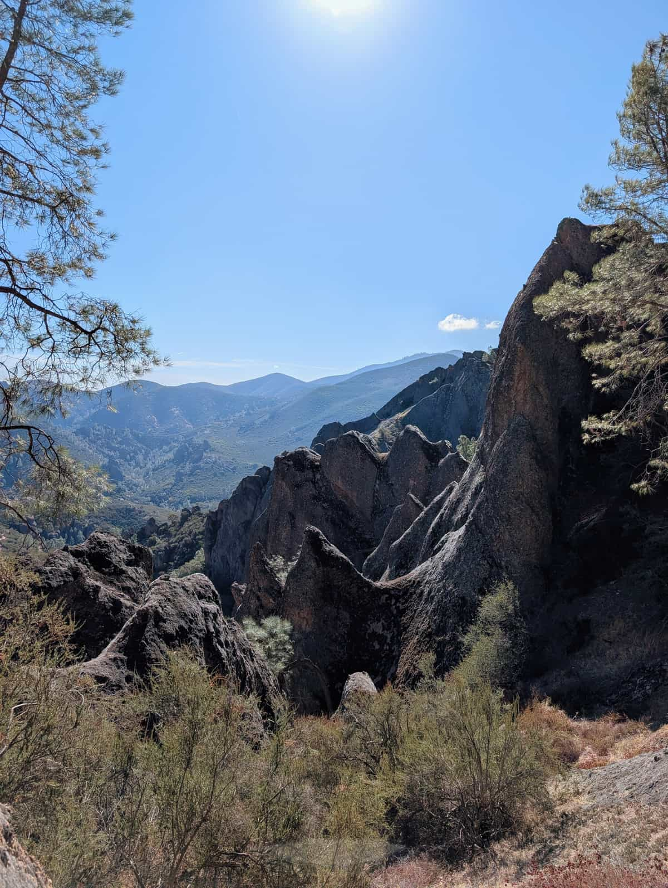
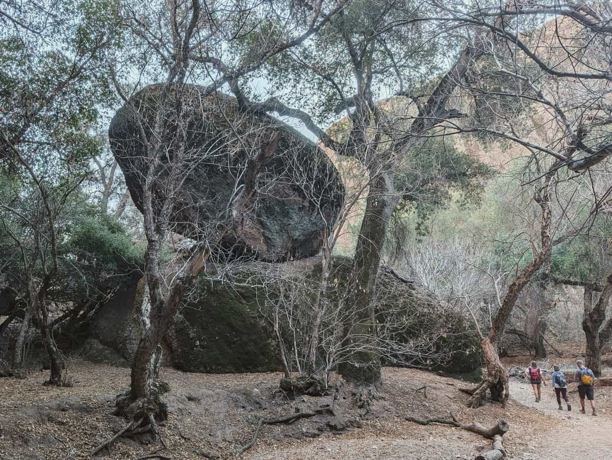
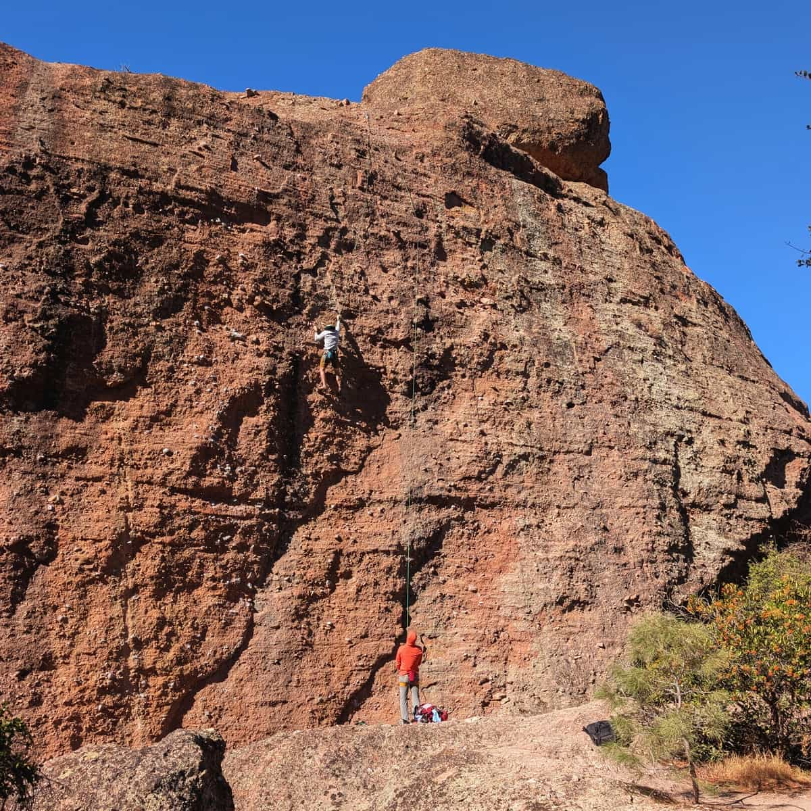
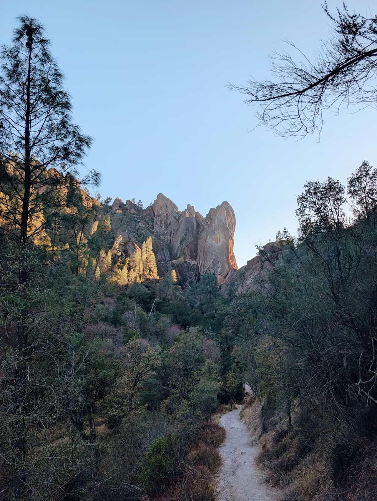
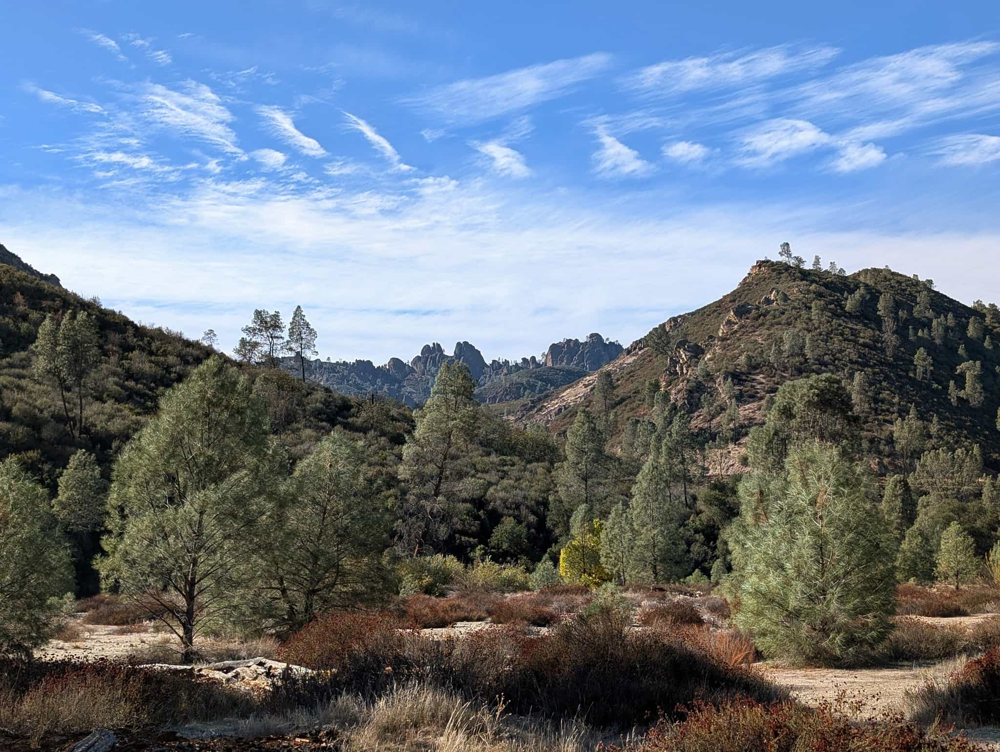

I'm still working on going through pictures but I had a great time driving out to Pinnacles National Park.
Hopefully will post more photos soon but in the meantime here are some cool rocks.

{.u-photo}

{.u-photo}

{.u-photo}

{.u-photo}

{.u-photo}

{.u-photo}

{.u-photo .post-image--wide}
