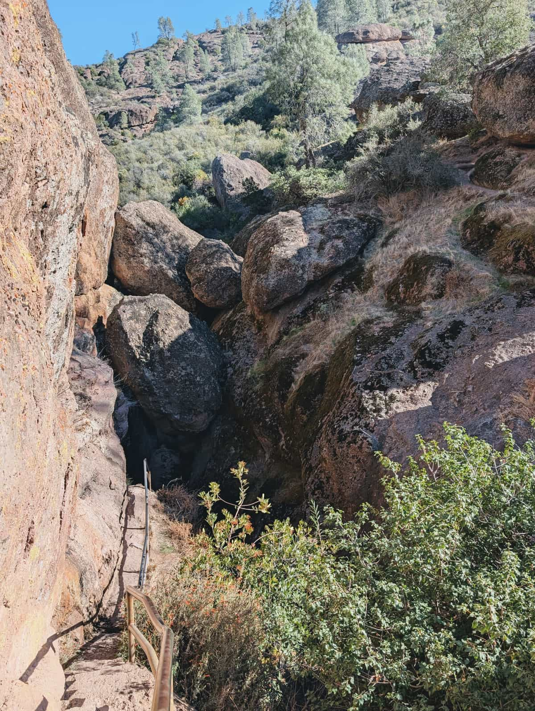
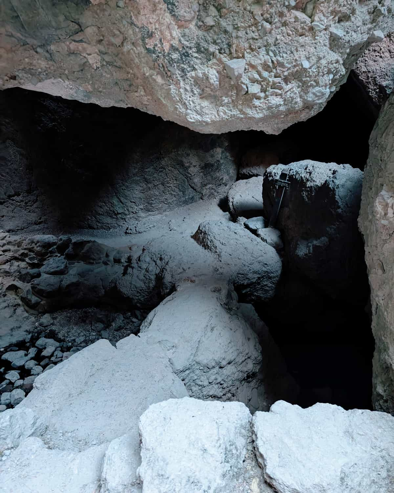
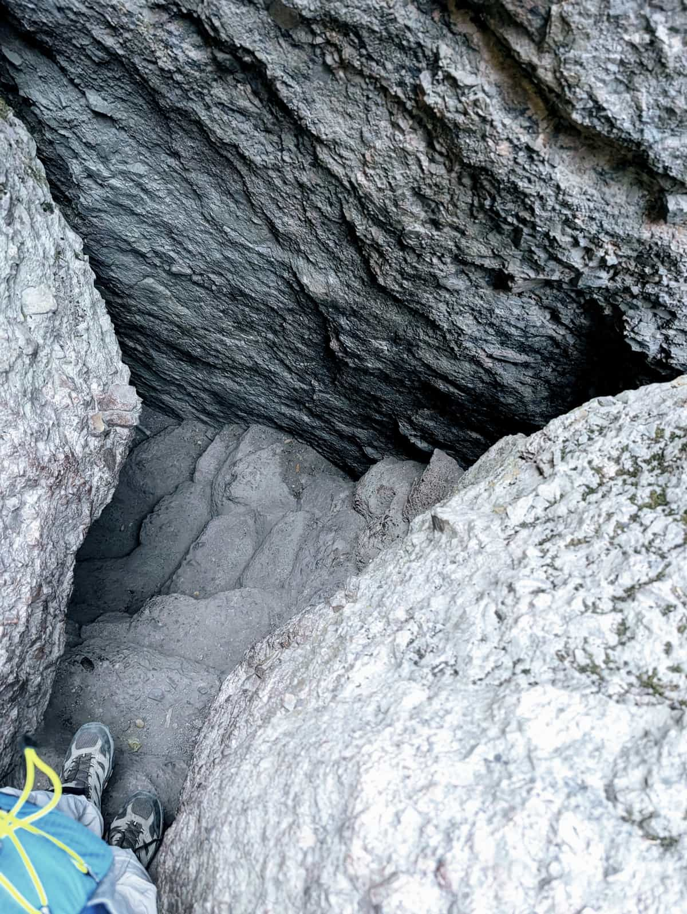
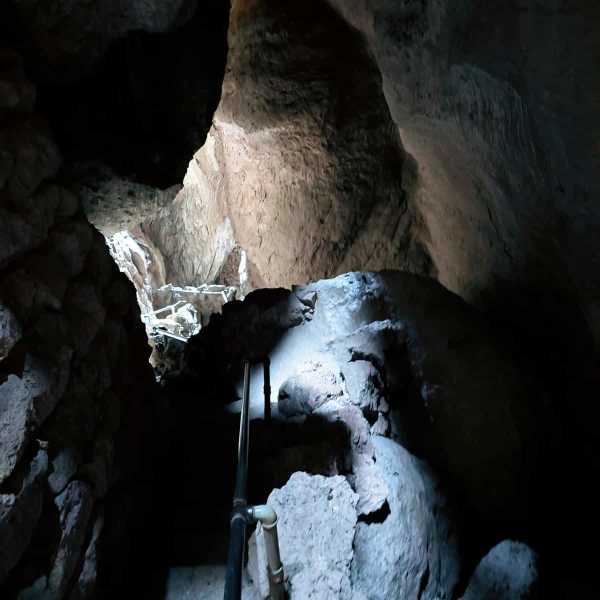
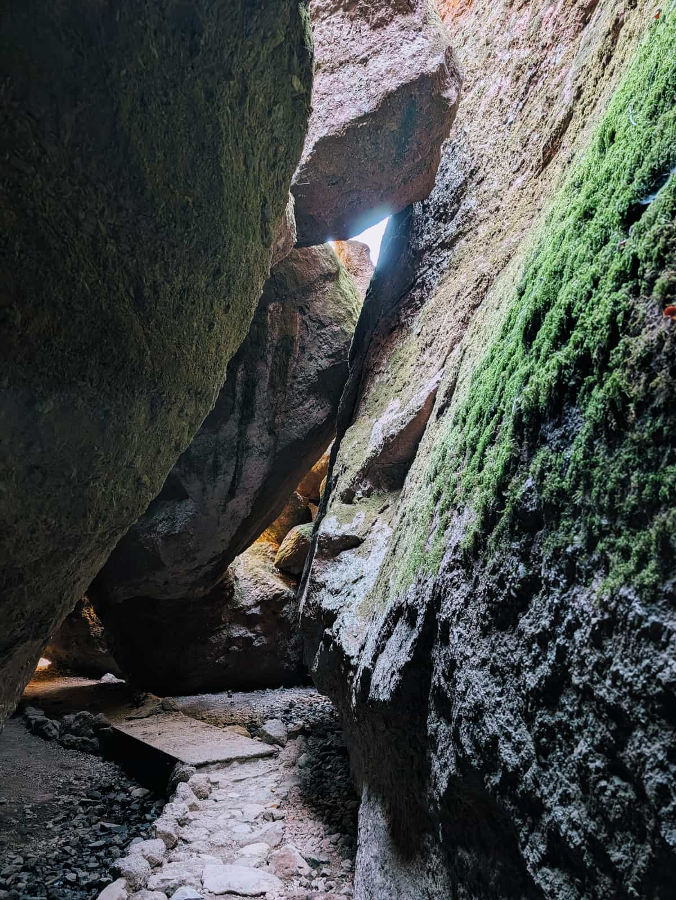
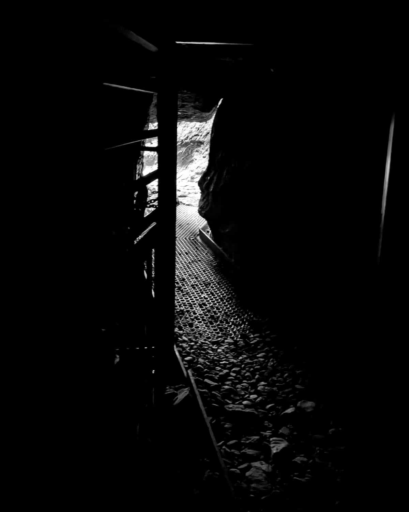
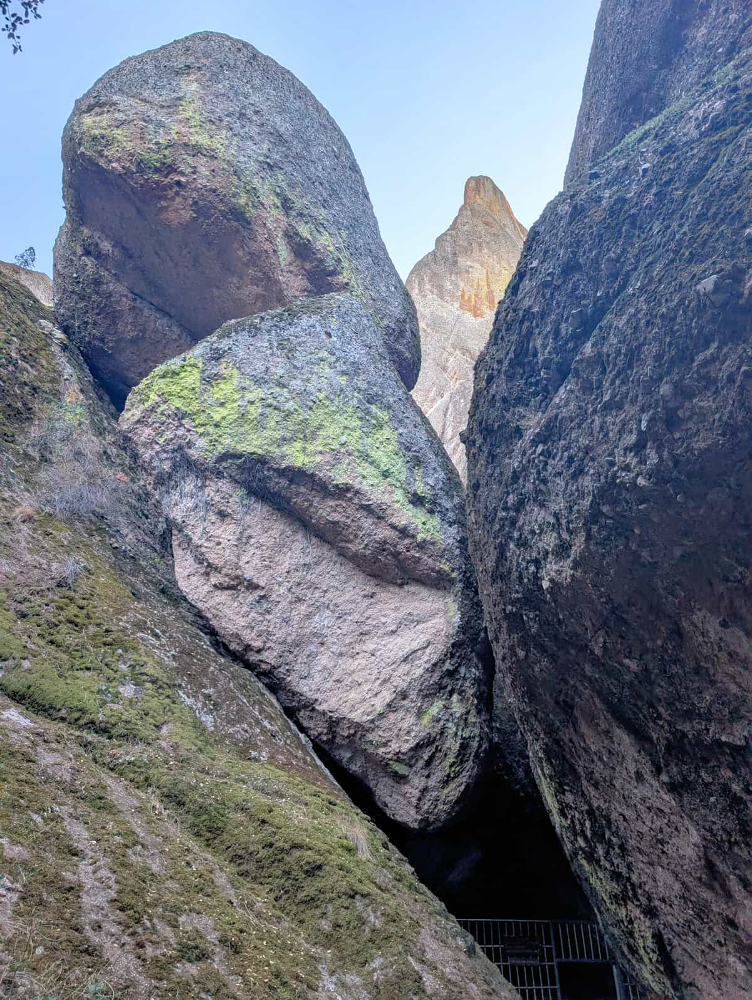
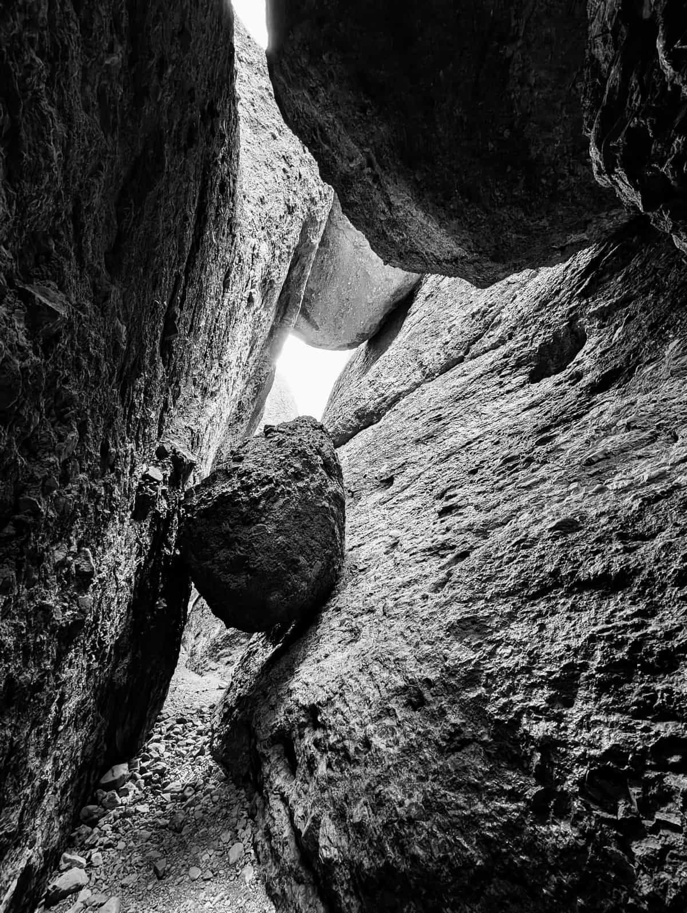
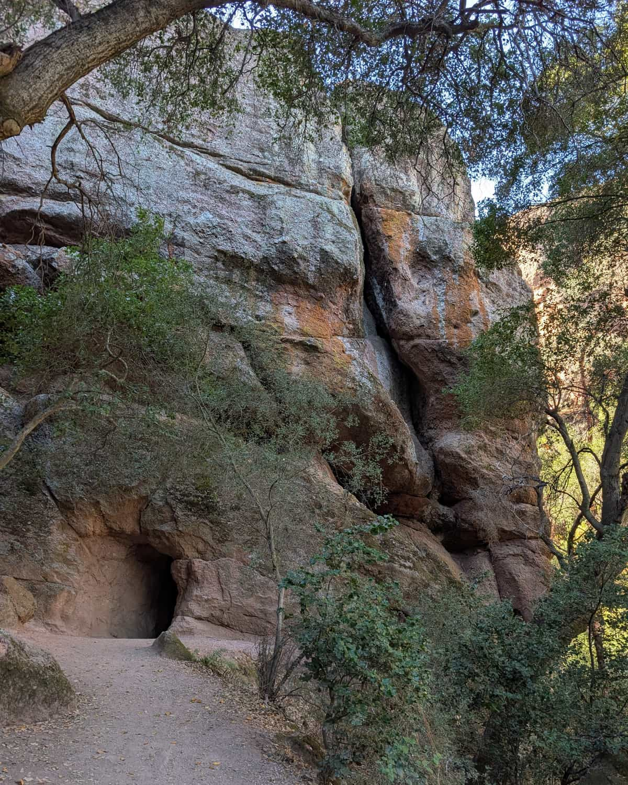

Pinnacles National Park has some cool peaks, but I was not prepared for how many caves there were.
If you ever visit, you should bring a flashlight so you can explore.
Be prepared for some tight squeezes, low ceilings, and to crawl your way out.
So I present...more dramatic rocks.

{.u-photo}

{.u-photo}

{.u-photo}

{.u-photo}

{.u-photo}

{.u-photo}

{.u-photo}

{.u-photo}

{.u-photo}
