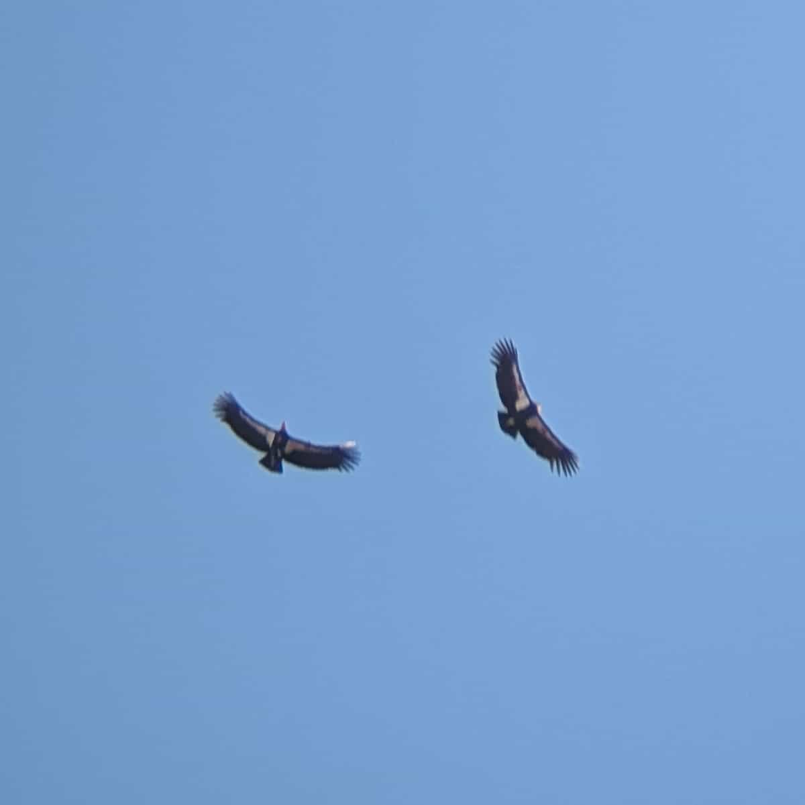
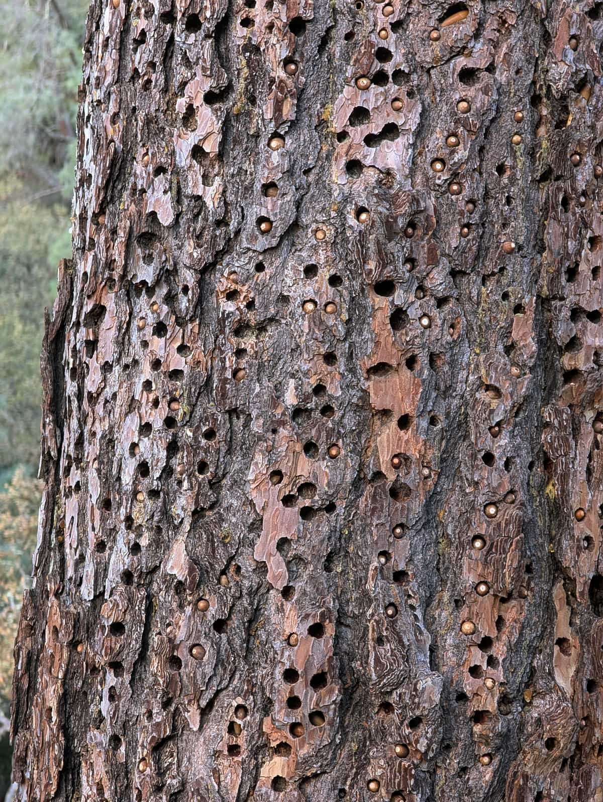
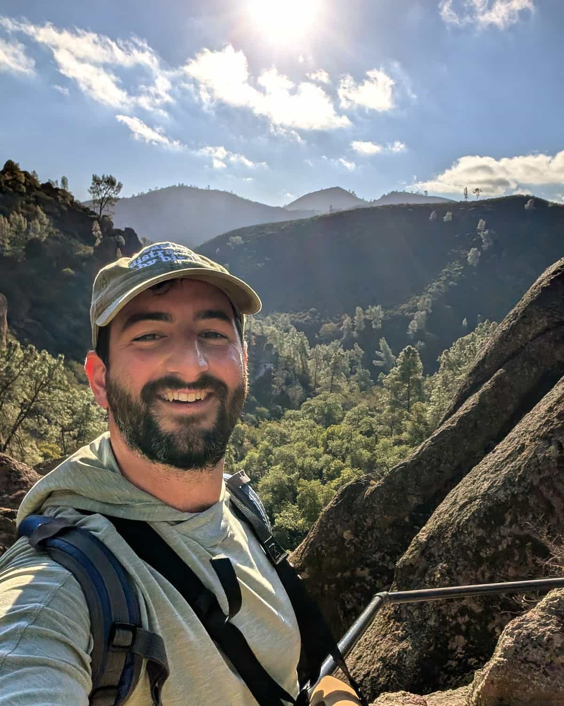
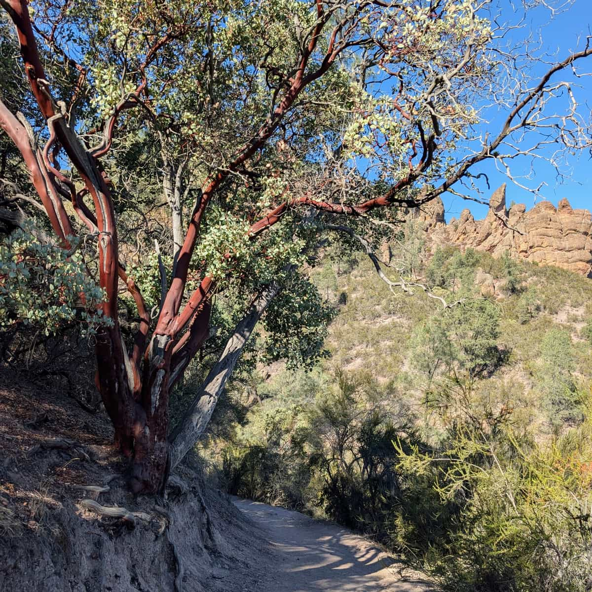
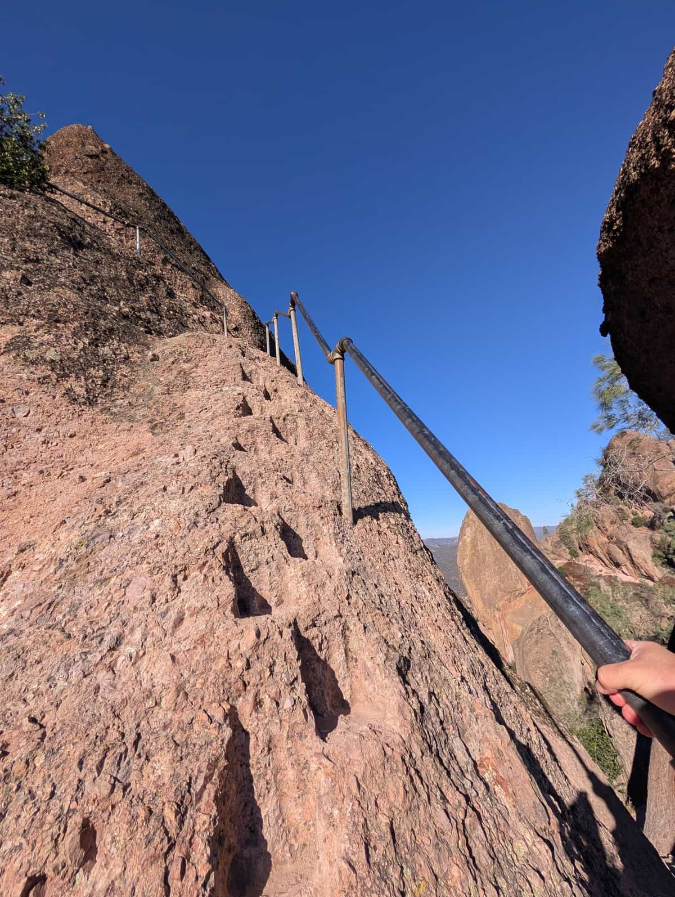
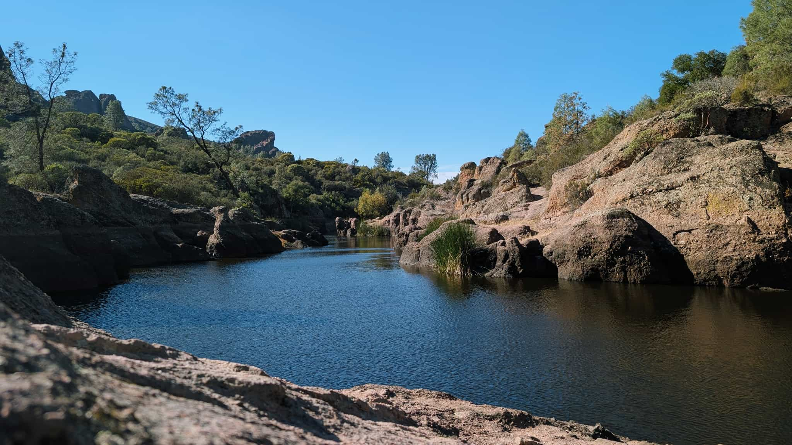
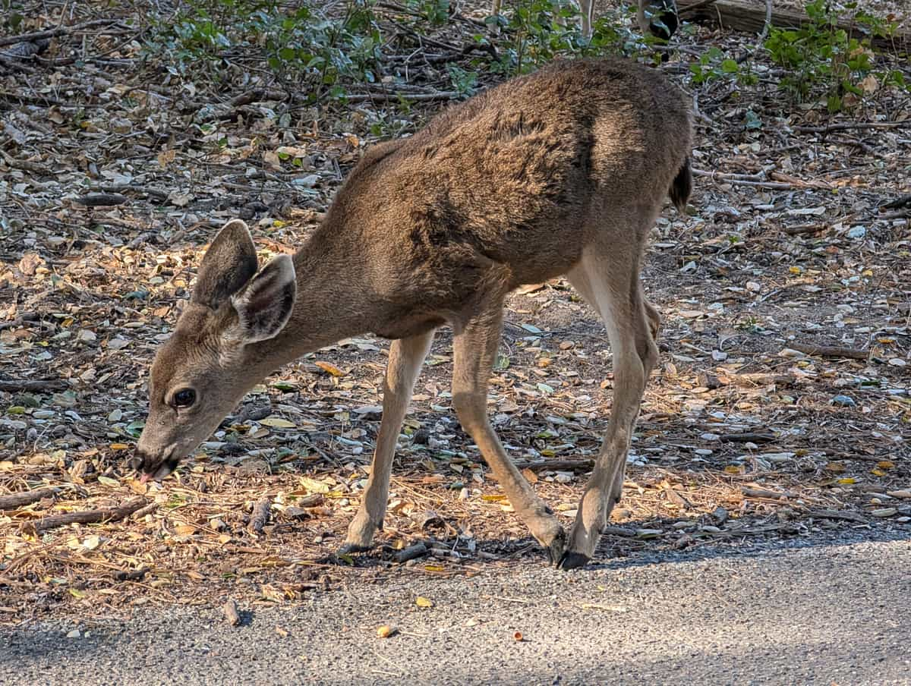
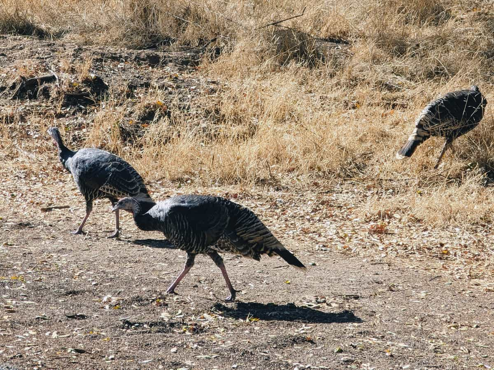
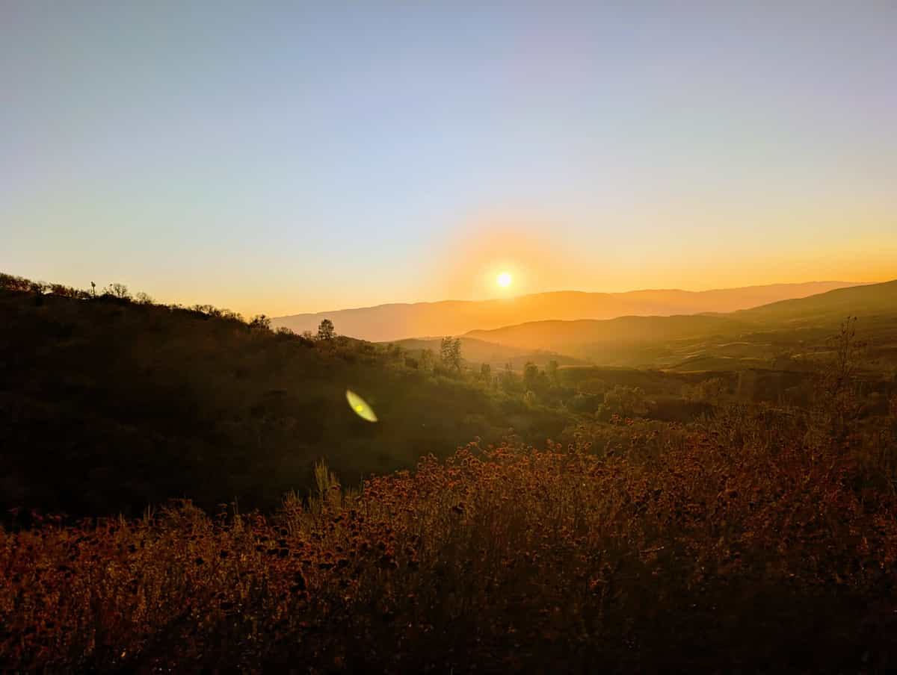

Alright, last photo dump from Pinnacles National Park.
It was not just rocks, there were great views and fun animals as well.

I was blessed to see condors on both days I was in the park.
I saw them soon after I arrived at the Balconies hike on the west side Wednesday afternoon.
It was great because at the end of the day the vultures and condors were all hanging around the park.
I got up early the next day for High Peaks Trail which was a great hike and I'm glad I got up at 6 AM.
When I started my hike around 8 AM I briefly saw condors when I started at Condor Gulch Trail but they were gone by the time I cleared the trees.
Still, there were plenty of other birds out and singing at that time, including the acorn woodpeckers that stuff trees full of nuts for a winter cache.

The trail takes you high above the park and has some really steep sections.
Thankfully the hardest parts have railings.
After getting the hardest part out of the way I took time to relax at Bear Gulch Reservoir before descending into the caves.
The reservoir was also my first good look at a [Canyon Wren](https://ebird.org/species/canwre) which I had been searching for all day.

Other fun finds were the deer which were all over, including two young rutting males and this young fawn.
In plants, the manzanitas trees were so striking with their red bark (as [Tracy Durnell also appreciates](https://tracydurnell.com/2026/11/13/tilden-botanic-garden/)).
The turkeys seemed fitting with Thankgiving coming shortly.
I wasn't sure what to expect at Pinnacles but in a day and a half I was pleased to have gotten some fantastic views.
From there I ended up going further north to Monterey which had more water than I bargained for.

{.u-photo}

{.u-photo}

{.u-photo}

{.u-photo}

{.u-photo}

{.u-photo .post-img--wide}

{.u-photo}

{.u-photo}

{.u-photo}
