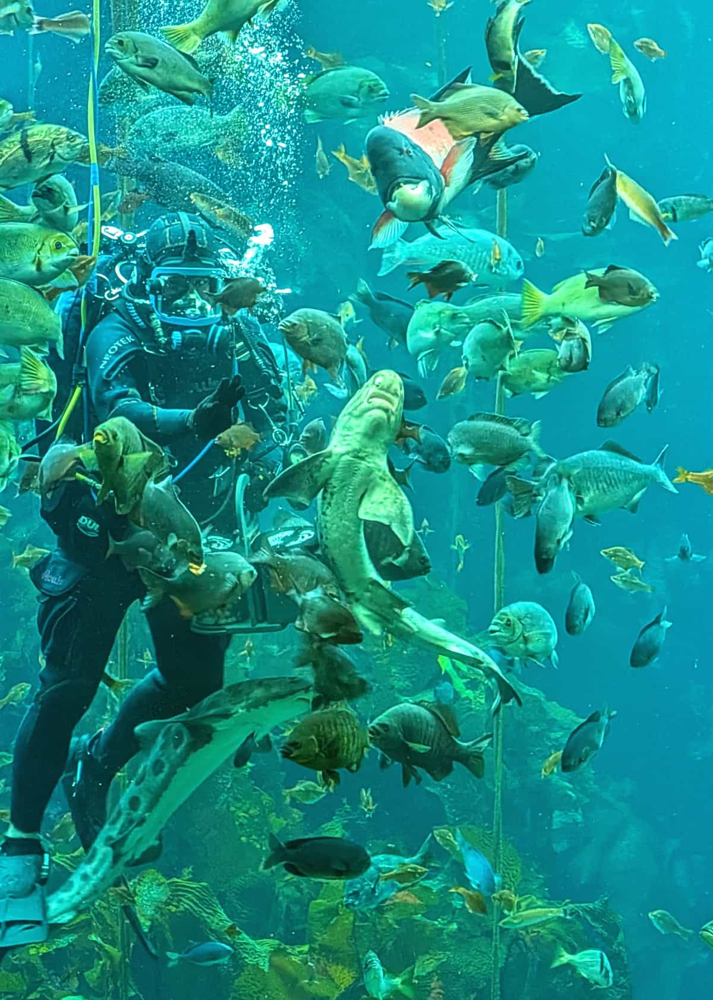
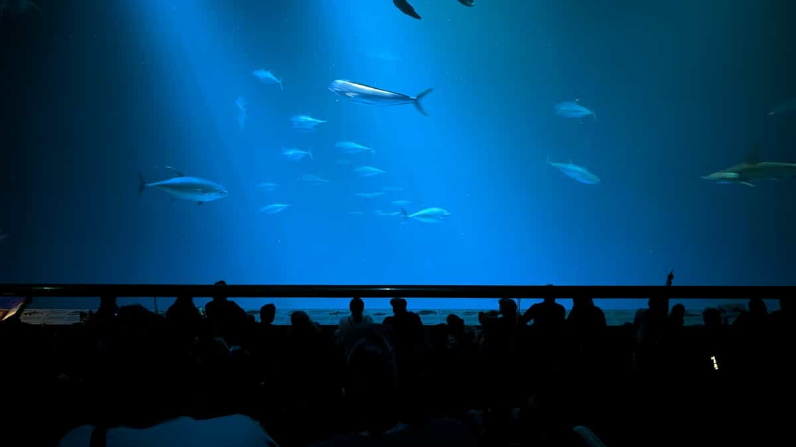
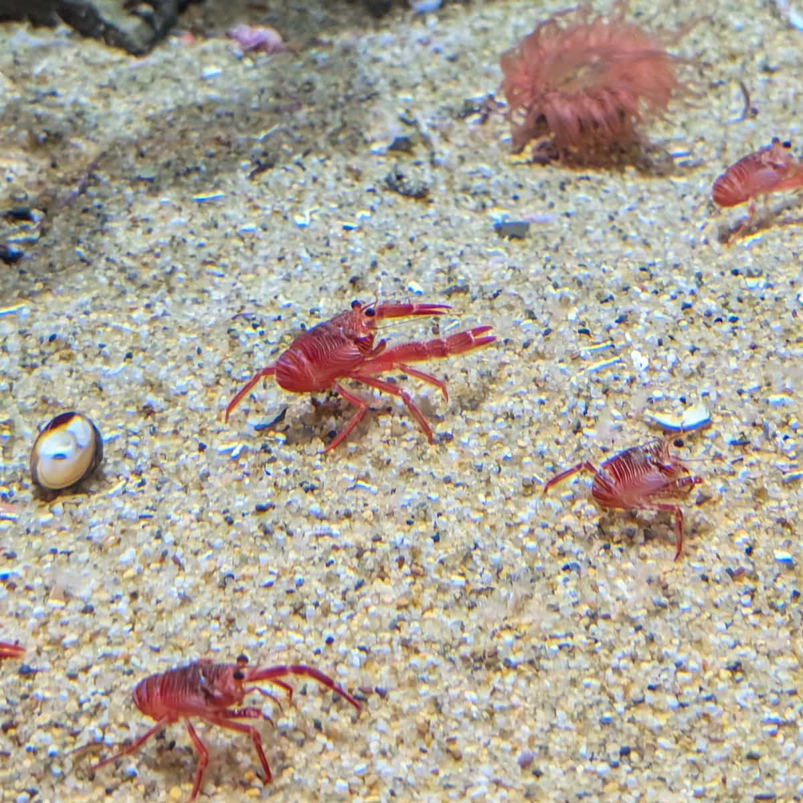
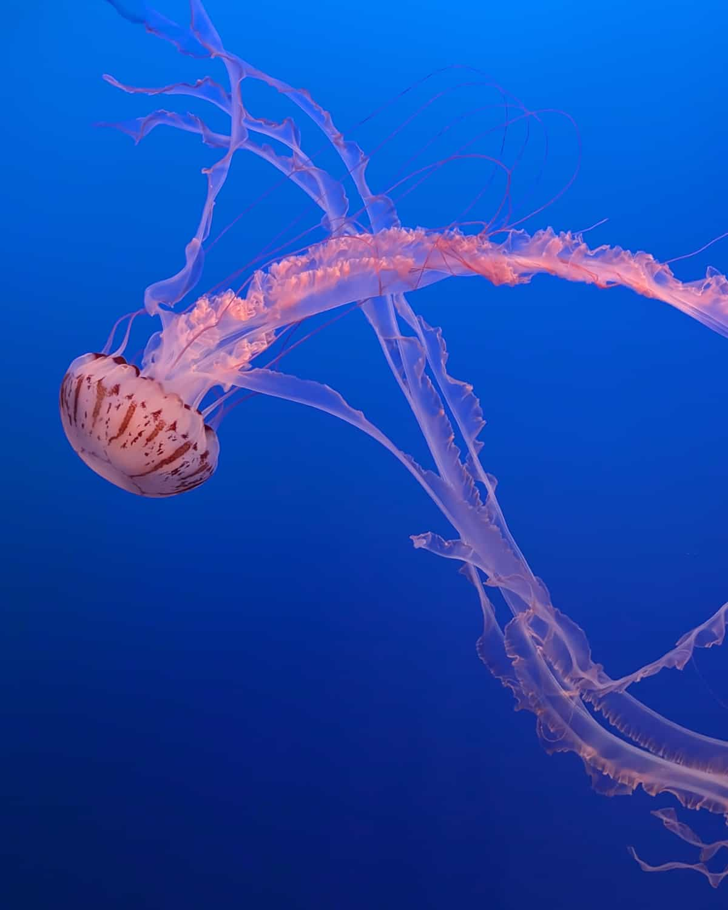
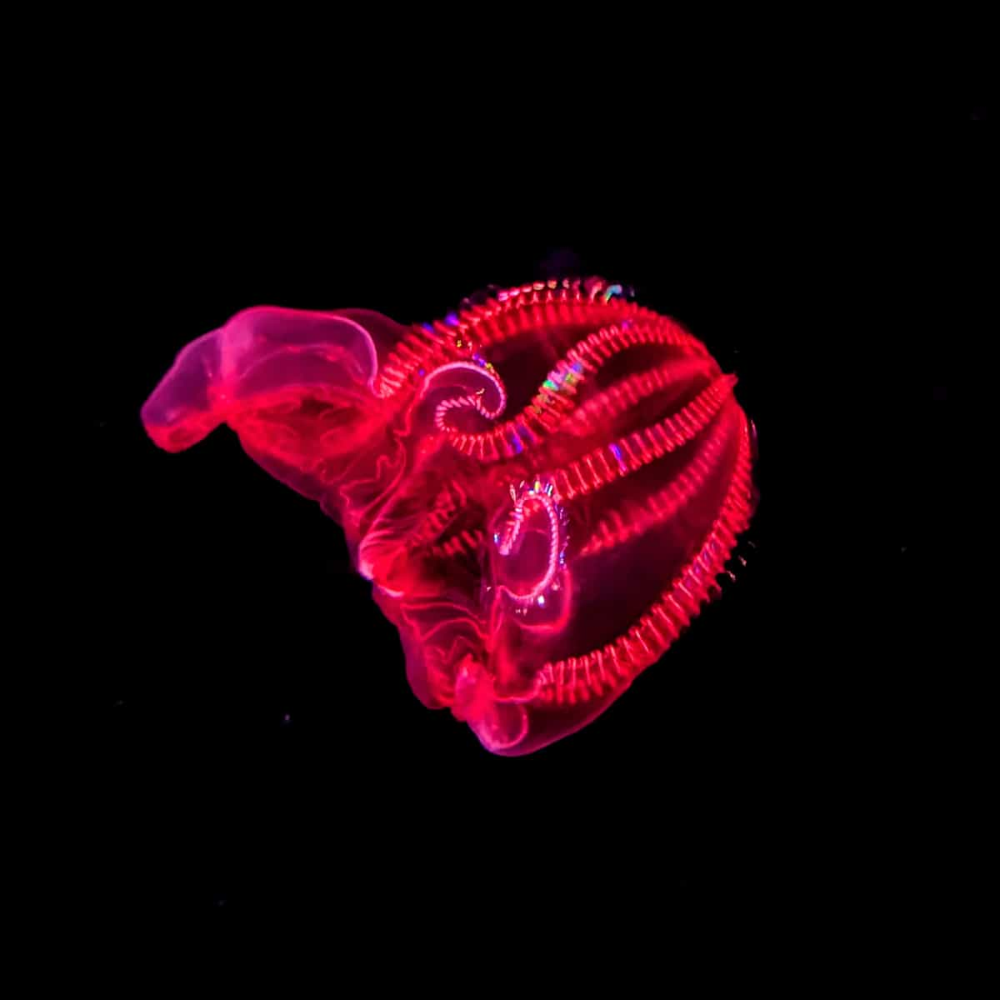
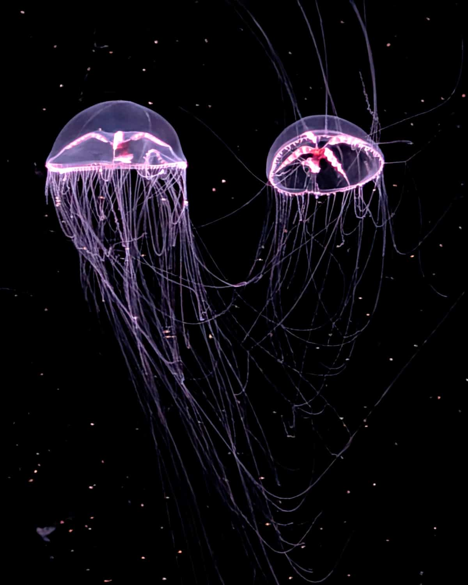
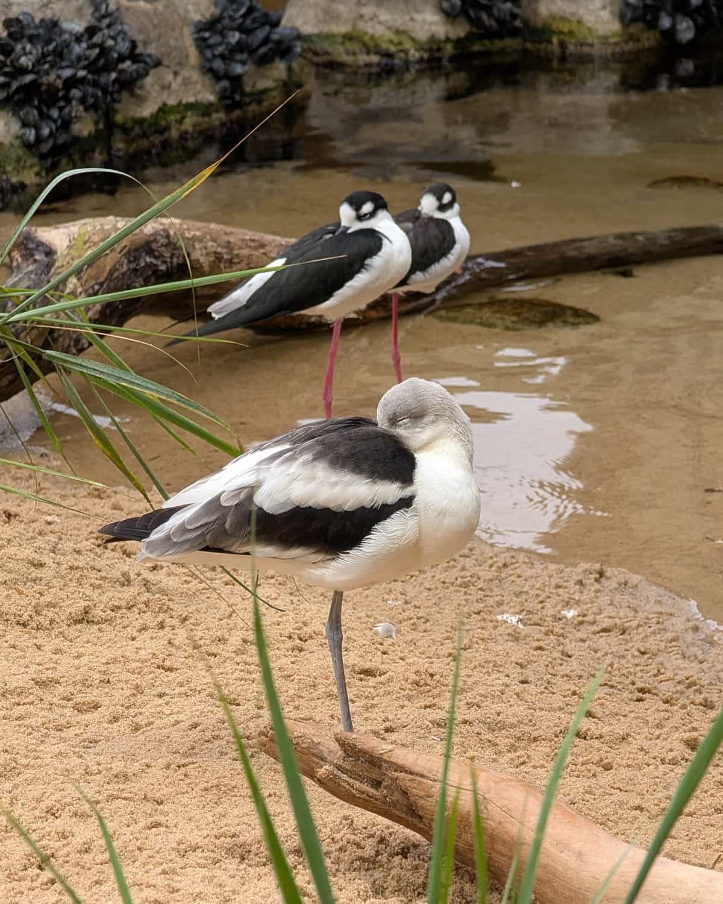
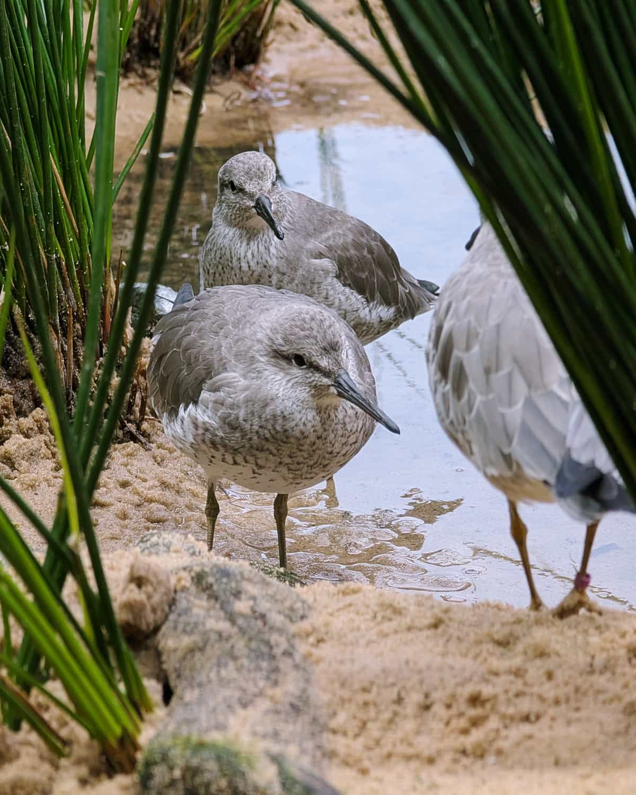

Monterey is only about an hour from Pinnacles National Park so I drove up and went to the aquarium.
I appreciated the way they framed Monterey's canning industry boom and bust as a reason it's important to understand and protect marine life.
It was better than I imagined with plenty of large tanks and a unique emphasis on the local marine life.
The sea otters were cute but it was a bit strange seeing them so close to their non-captive relatives who were visible behind the aquarium.
The jelly fish were some of the most photogenic exhibits as usual.
But they also had some good interpretive talks about the open ocean, sea birds, and a diver talking from inside the tank.
I personally liked how many birds were on exhibit.
It's always cool to see puffins fly underwater or sandpipers pulling insects from the sand at a close range.

{.u-photo}

{.u-photo}

{.u-photo}

{.u-photo}

{.u-photo}

{.u-photo}

{.u-photo}

{.u-photo}

<figure>
<video src="/assets/img/2026-monterey-aquarium-reef.mp4" controls autoplay muted loop class="u-video" aria-label="Various fish being swished around by a turbulent current in a reef exhibit">
If you can't see the video, you can <a href="/assets/img/2026-monterey-aquarium-reef.mp4" download="">download the file</a>.
</video>
</figure>
