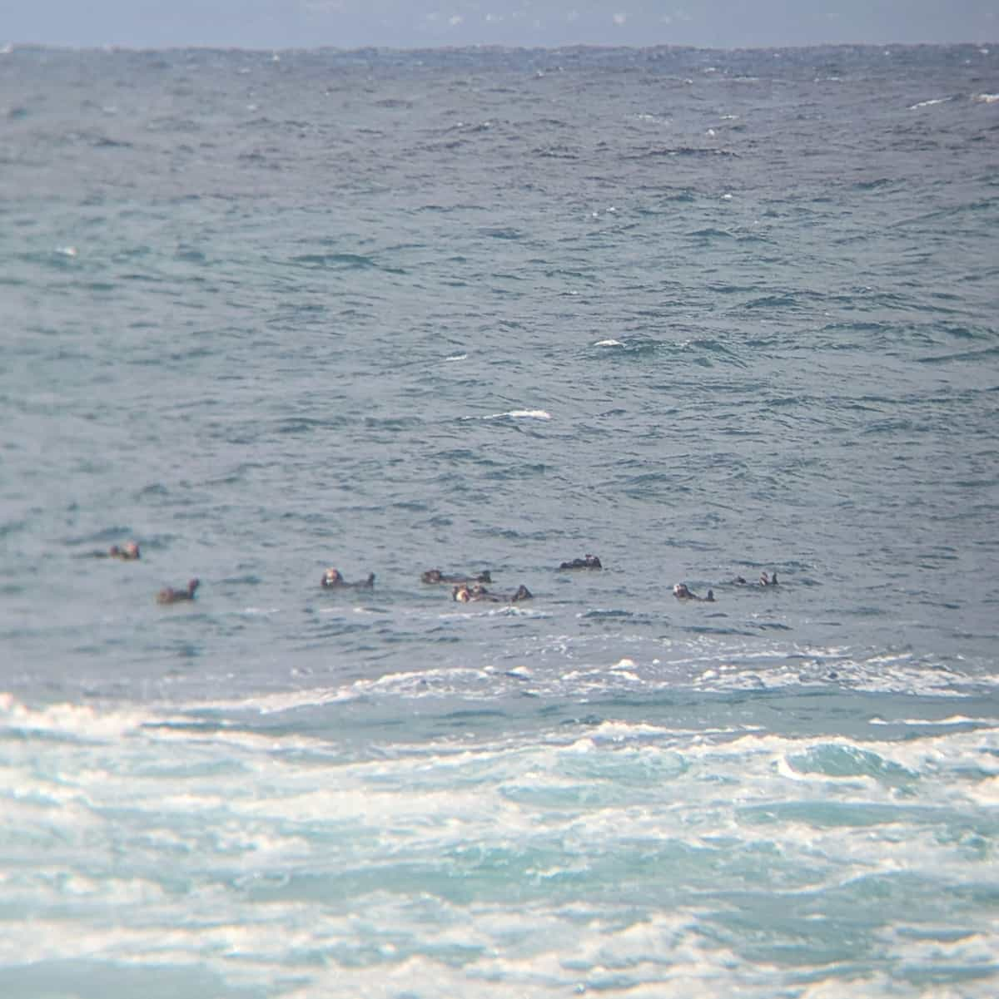
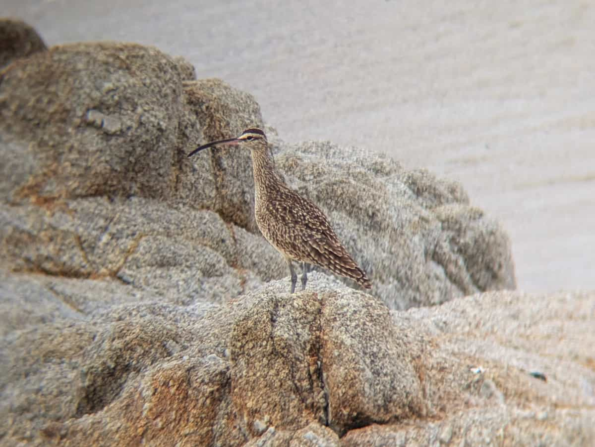
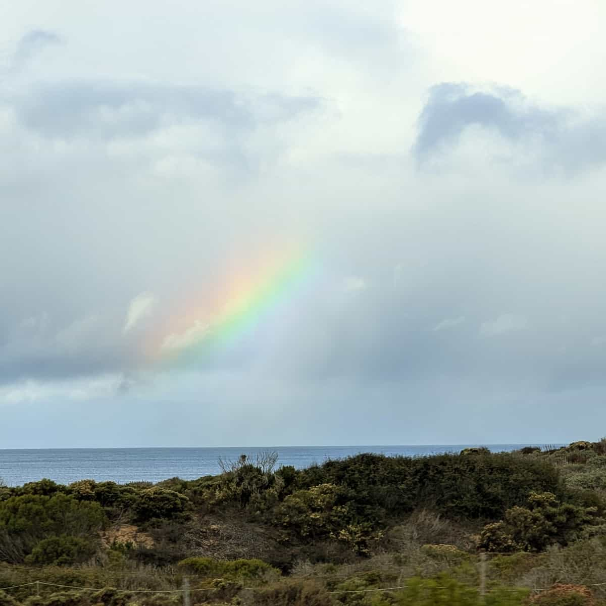

A few more shots from Monterey's shores, mostly some of the birds I saw.
Species are on my [ebird list](https://ebird.org/checklist/S410279764) (linked on my website for Instagram viewers).
This was after a downpour and while some swells were starting to hit the coast.

<figure>
<video src="/assets/img/2026-monterey-shore-black.mp4" autoplay muted loop class="u-video" aria-label="A black bird walks over rocks">
If you can't see the video, you can <a href="" download="/assets/img/2026-monterey-shore-black.mp4">download the file</a>.
</video>
</figure>

{.u-photo}

<figure>
<video src="/assets/img/2026-monterey-shore-oystercatcher.mp4" autoplay muted loop class="u-video" aria-label="A short black bird with a long, bright orange bill walks on a shore with waves crashing behind">
If you can't see the video, you can <a href="" download="/assets/img/2026-monterey-shore-oystercatcher.mp4">download the file</a>.
</video>
</figure>

{.u-photo}

<figure>
<video src="/assets/img/2026-monterey-shore-ruddy.mp4" autoplay muted loop class="u-video" aria-label="A stubby, brown and white bird with orange legs walks on a rocky shoreline.">
If you can't see the video, you can <a href="" download="/assets/img/2026-monterey-shore-ruddy.mp4">download the file</a>.
</video>
</figure>

{.u-photo}
