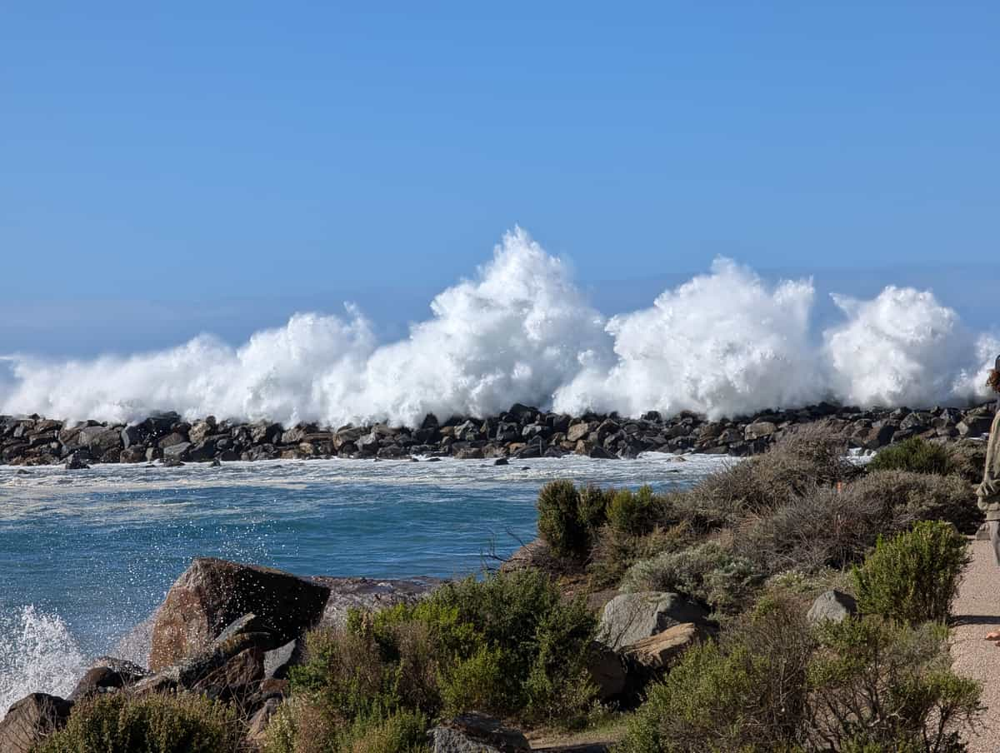
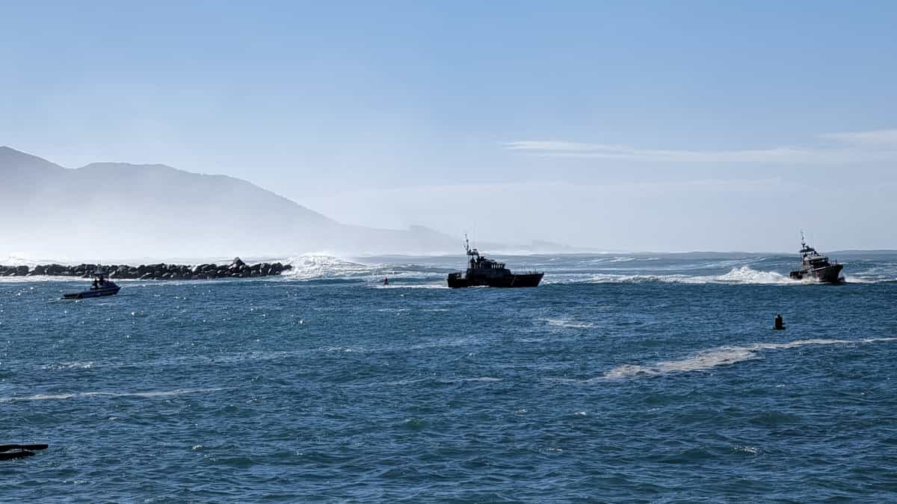
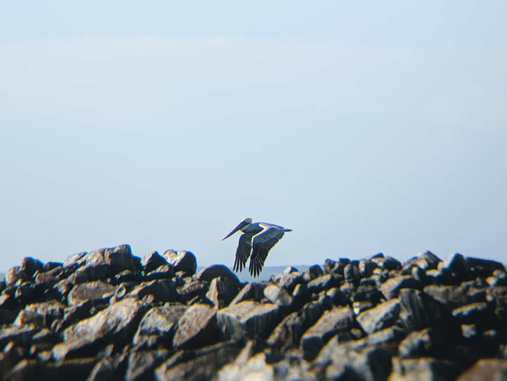
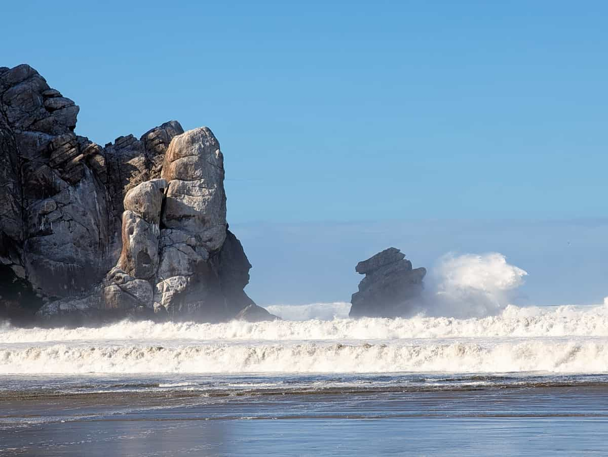
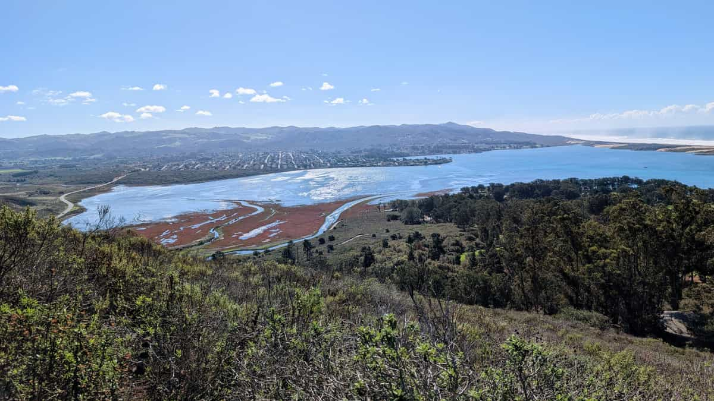
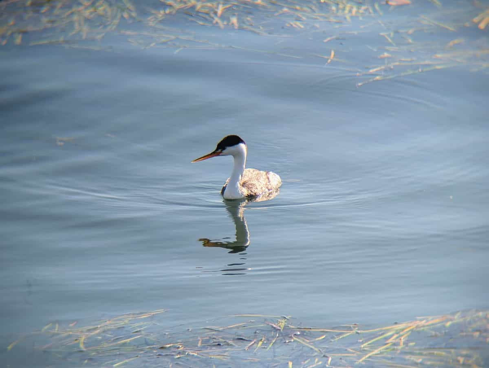
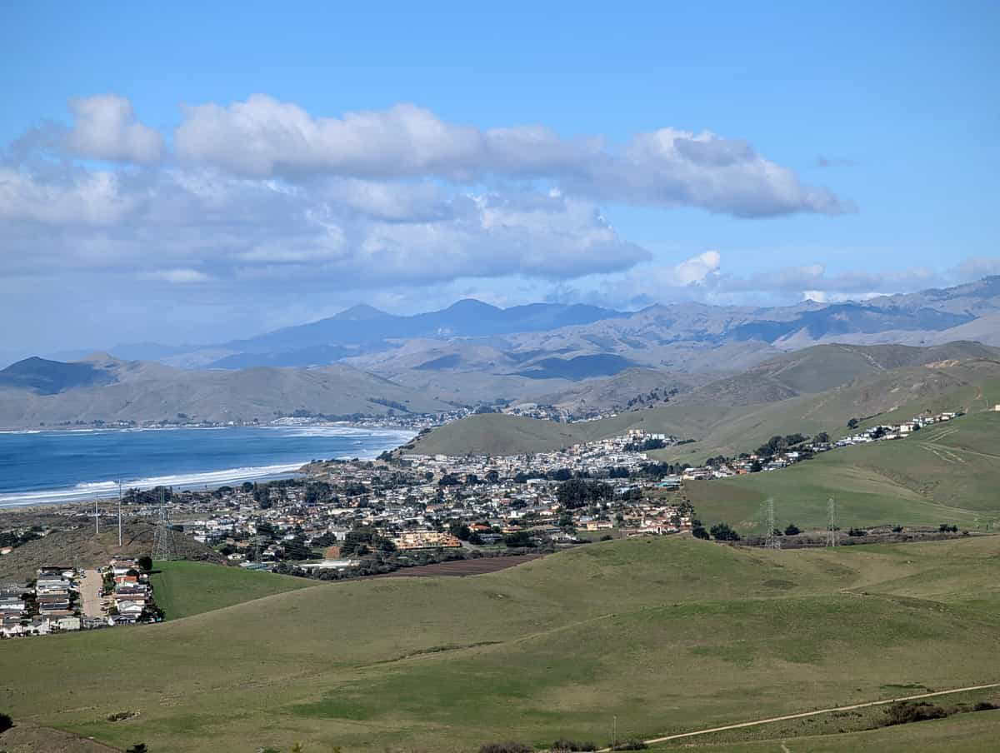

On my way home, I stopped at Morro Bay.
You may have seen some videos of crazy waves, but it was cool, and a bit terrifying to see them in person.
One one side of the bay the waves were pounding into the breakwater.
The coast guard came out when a kayaker got a bit close to the waves and then they hung out, standing guard facing the waves.
On the other side of the bay the waves only had a small section of rock to crash into, but even the rolling whitewash coming into the beach seemed a bit terrifying.

While there I was pleased to find several birds like Clark's Grebe and Red-throated Loons.
After being on the beach I headed up Black Hill to get a view of the town and Chestnut-backed Chickadees.
It was definitely worth the stop.

{.u-photo}

{.u-photo}

{.u-photo}

{.u-photo}

<figure>
<video src="/assets/img/2026-morro-bay-waves.mp4" autoplay muted loop class="u-video" aria-label="Short animation of waves crashing into a sea wall while a pelican flies over">
If you can't see the video, you can <a href="" download="/assets/img/2026-morro-bay-waves.mp4">download the file</a>.
</video>
</figure>

{.u-photo}

{.u-photo}

{.u-photo}
